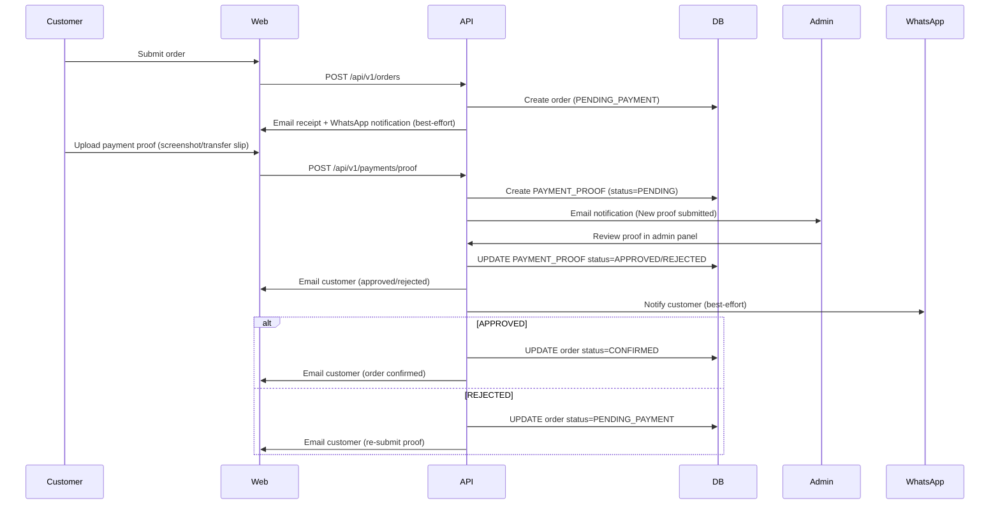

# Architecture

## Overview

The **Engineering Lab** store consists of three primary layers:

- **Web (React/Vite)** — hosted on Vercel; SPA with SSR‑fallback, meta‑tags, JSON‑LD, and API‑generated `sitemap.xml`/`robots.txt`.
- **API (Express/Node)** — long‑running service on Render/Railway; PostgreSQL + Prisma + JWT refresh‑cookie auth + cron jobs + Cloudinary storage + pdfkit invoices.
- **Database** — managed PostgreSQL (Neon/Supabase/Railway/Render Postgres) with `pg_trgm` and `unaccent` extensions, automated backups, connection pooling via Prisma.

Domains:

| Layer | Default Domain | Custom Domain |
|-------|---------------|---------------|
| API | `https://engineering-lab-api.onrender.com` | `api.engineering-lab.com` |
| Web | `https://engineering-lab.com` (Vercel) | `www.engineering-lab.com` |
| DB | *managed PostgreSQL* | — |

## Data Model (ER Diagram)

```mermaid
erDiagram
    USER ||--|{ ORDER : places
    USER ||--|{ REVIEW : writes
    USER ||--|{ NOTIFICATION_LOG : receives
    USER {|--|{ ORDER_STATUS_HISTORY : changes
    USER {id, email, phone, locale, isActive, role}
    
    ORDER ||--|{ ORDER_STATUS_HISTORY : history
    ORDER ||--|{ ORDER_ITEM : contains
    ORDER ||--|{ PAYMENT_PROOF : submitted
    ORDER }o--|{ PRODUCT : items
    ORDER ||--|{ COUPON : applied
    
    PRODUCT ||--|{ PRODUCT_IMAGE : images
    PRODUCT ||--|{ PRODUCT_VARIANT : variants
    PRODUCT ||--|{ BUNDLE_ITEM : bundles
    PRODUCT ||--|{ CATEGORY : classified under
    PRODUCT ||--|{ BRAND : from
    
    CATEGORY ||--|{ PRODUCT : products
    BRAND ||--|{ PRODUCT : products
    
    SETTING {key, value (JSON)
    
    NOTIFICATION_LOG {id, userId, channel, template, locale, payload, status, error

USER {
    id PK,
    email UK,
    phone,
    locale,
    isActive,
    role PK,
    createdAt,
    updatedAt
}

ORDER {
    id PK,
    orderNumber,
    userId FK,
    status,
    paymentMethod,
    paymentDeadlineAt,
    subtotal,
    discountTotal,
    shippingFee,
    total,
    contactName,
    contactEmail,
    contactPhone,
    addressSnapshot JSON,
    createdAt,
    updatedAt
}

ORDER_STATUS_HISTORY {
    id PK,
    orderId FK,
    from,
    to,
    note,
    createdAt
}

ORDER_ITEM {
    id PK,
    orderId FK,
    productId FK,
    variantId FK,
    qty,
    unitPrice,
    lineTotal
}

PRODUCT {
    id PK,
    sku UK,
    nameAr,
    nameEn,
    slug,
    price,
    soldCount,
    isActive,
    categoryId FK,
    brandId FK,
    createdAt,
    updatedAt
}

CATEGORY {
    id PK,
    nameAr,
    nameEn,
    slug,
    sortOrder,
    isActive,
    parentId FK
}

BRAND {
    id PK,
    nameAr,
    nameEn,
    slug,
    isActive,
    createdAt
}

PRODUCT_IMAGE {
    id PK,
    productId FK,
    url,
    isPrimary,
    sortOrder
}

PAYMENT_PROOF {
    id PK,
    orderId FK,
    userId FK,
    proofImageUrl,
    status,
    reviewedAt,
    reviewedBy FK
}

SETTING {
    id PK,
    key UK,
    value JSON,
    createdAt,
    updatedAt
}

NOTIFICATION_LOG {
    id PK,
    userId FK,
    channel,
    template,
    locale,
    payload JSON,
    status,
    error,
    createdAt
}
```

## Order State Machine Diagram

```mermaid
stateDiagram-v2
    [*] --> PENDING_PAYMENT
    note right of PENDING_PAYMENT: Customer places order; payment deadline starts
    
    state PENDING_PAYMENT {
        [*] --> ACTIVE
        active
        PENDING_PAYMENT --> EXPIRED : payment deadline expired
        PENDING_PAYMENT --> CONFIRMED : payment proof submitted & approved
    }
    
    state ACTIVE {
        [*] --> SHIPPED
        active
        ACTIVE --> CANCELLED : admin cancels
        ACTIVE --> COMPLETED : order delivered
    }
    
    EXPIRED --> COMPLETED : full refund & order closed
    CONFIRMED --> SHIPPED : admin ships order
    SHIPPED --> COMPLETED : customer confirms delivery
    COMPLETED --> [*]
```

## Payment‑Proof Flow Diagram



## Domains & DNS

| Sub‑domain | Purpose | Points to |
|------------|---------|-----------|
| `api.engineering-lab.com` | API service (Render/Railway) | Managed PostgreSQL + managed Cloudinary |
| `www.engineering-lab.com` | Web (Vercel) | Vercel production preview |
| `engineering-lab.com` | Apex domain → HTTPS + redirects | Managed via DNS (Route 53/Cloudflare) |
| `sitemap.engineering-lab.com` | Generated `sitemap.xml` (API endpoint) | — |
| `robots.engineering-lab.com` | Generated `robots.txt` (API endpoint) | — |

## Secrets & Configuration

- All secrets (`DATABASE_URL`, `JWT_ACCESS_SECRET`, `SMTP_PASS`, `WHATSAPP_ACCESS_TOKEN`, Cloudinary keys) **must not be committed**.
- `.env` files are git‑ignored; values are injected by the hosting platform (Vercel, Render, Railway).
- `COOKIE_SECURE=true` and `COOKIE_SAME_SITE=none` are required when the API and web are on different origins.
- Google OAuth `GOOGLE_CLIENT_ID`/`SECRET` must be configured for production origins in the Google Cloud Console.

## Deployment Notes

- **Vercel**: auto‑deploy on `main` push; rewrite `/api/*` to the API service via `vercel.json`; `vercel.json` also adds security headers and cache‑control for hashed assets.
- **Render/Railway**: Dockerfile (multi‑stage, non‑root) runs the API; managed PostgreSQL provides the DB; Redis (optional) for rate‑limit/store cache.
- **Self‑hosting**: `docker-compose.prod.yml` runs Nginx/Caddy reverse‑proxy, API container, PostgreSQL, Redis; TLS via Let's Encrypt (Caddy) or custom certs.
- **Migration workflow**: `prisma migrate deploy` as a release step; backup the DB before destructive migrations; never edit applied migration files.
- **Rollback**: `prisma migrate rollback <target>` or restore from `scripts/backup.sh` backup.
- **Monitoring**: Uptime Robot/BetterStack on `/health` and `/ready`; Sentry for API and web errors; log retention 30 days.
- **Backups**: Daily `pg_dump` to encrypted storage; tested restore procedure documented in `docs/troubleshooting.md`.
- **Cost tiers**: 
  - Vercel Hobby (free) → switch to Pro for custom domains & team features.
  - Render Hobby → upgrade to Cloud/Scaled for always‑on instances + higher bandwidth.
  - Neon/Supabase free tier → scale to paid as traffic grows.
  - Cloudinary free tier (25 GB bandwidth) → upgrade as image volume increases.
  - Email (Resend/Brevo) free tier → upgrade for higher volume.
- **Scaling first**: add Redis for rate‑limit/store cache, then move to always‑on API instances, then read‑replica PostgreSQL.